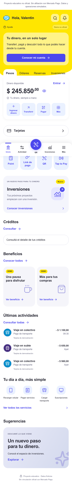
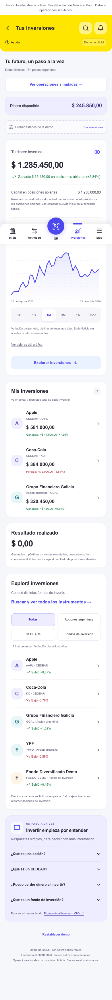
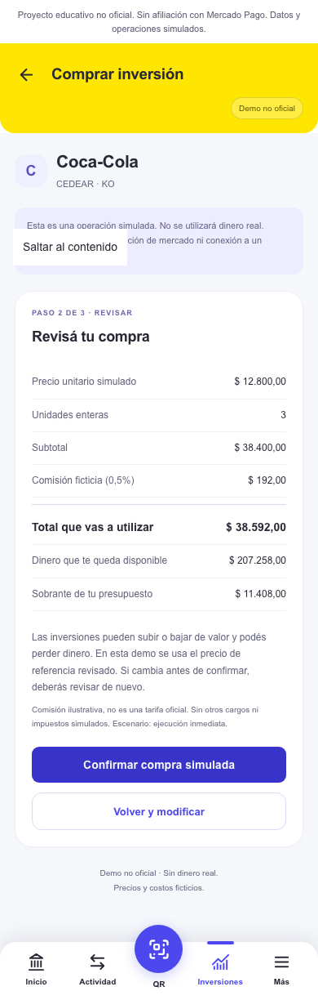

# Mercado Pago Investments — Unofficial UX/UI Concept

Propuesta educativa de integración de inversiones en una aplicación de pagos digitales, enfocada en accesibilidad financiera, UX/UI y desarrollo frontend.

**Proyecto educativo no oficial. Sin afiliación con Mercado Pago. Datos y operaciones simulados.**

## Problema y propuesta

¿Cómo incorporar inversiones sin intimidar a quien nunca invirtió? Este concepto conserva el Home, los colores y la navegación familiar, y propone descubrir empresas, entender un CEDEAR y revisar una operación en pesos antes de confirmarla. La hipótesis es que la familiaridad y la información progresiva podrían facilitar la comprensión; no fue validada con usuarios reales.

## Funcionalidades implementadas

- Home personalizado para Valentin y saldo compartido con Inversiones.
- Cartera, resultados realizados/no realizados, privacidad de importes, períodos y tabla accesible del gráfico.
- Explorador de doce instrumentos ficticios con búsqueda normalizada, categorías y favoritos persistentes.
- Fichas con precio en ARS, explicación, riesgos y evolución simulada.
- Compra por presupuesto y venta por unidades, validación, revisión de costos y confirmación.
- Historial y detalle de órdenes; escenarios enviados, pendientes, ejecutados, cancelados y rechazados.
- Persistencia local validada, protección frente a confirmaciones duplicadas y recuperación explícita.

No hay autenticación, APIs bursátiles, backend, brokers ni movimientos reales. Los accesos de billetera fuera del alcance muestran un aviso de demostración.

## Tecnología y arquitectura

Next.js App Router, React, TypeScript estricto, Tailwind/CSS, Lucide y Recharts. Node.js 24 LTS recomendado (rango admitido en package.json). Se utilizan fuentes del sistema y no se cargan fuentes ni fotografías remotas.

El motor financiero usa centavos enteros, operaciones intermedias con BigInt y costo promedio racional. Los componentes leen una sola cuenta mediante useSyncExternalStore. Las mutaciones se serializan con Web Locks, se validan nuevamente y se guardan antes de actualizar la interfaz. Se reproduce el registro de eventos al recuperar datos para detectar inconsistencias. Ver [modelo financiero y ejemplos exactos](docs/OPERATIONS.md).

```text
src/app/                      Rutas, layouts, errores y estilos
src/components/home/          Home inspirado en las referencias
src/components/investments/   Cartera, catálogo, gráficos y operaciones
src/components/layout/        Encabezado, navegación y avisos
src/lib/trading/               Dinero, motor, persistencia e historial
src/lib/investments/           Catálogo, búsqueda y favoritos
src/lib/mocks/                 Precios, series y posiciones ficticias
src/types/                    Contratos de datos
 tests/                       Unitarios e integración React/JSDOM
 e2e/                         Recorridos Chromium y axe
 docs/                        Auditoría, case study y despliegue
```

## Instalación y ejecución

```bash
npm ci
npm run dev
```

Abrir http://localhost:3000. No se necesitan variables de entorno ni credenciales.

```bash
npm run check
npm run build
npx playwright install chromium
npm run test:e2e
```

Las pruebas E2E arrancan el build de producción en 127.0.0.1:3100 y usan contextos aislados; ese puerto debe estar libre. `npm run check` ejecuta lint, TypeScript y pruebas unitarias/integración. `npx playwright show-report` abre el último informe. Para servir producción manualmente: `npm start`.

## Capturas

Capturas reales del build local, generadas por Playwright:

| Home | Inversiones | Revisión de compra |
| --- | --- | --- |
|  |  |  |

## Verificación y decisiones de producto

- [Auditoría y resultados de pruebas](docs/AUDIT.md).
- [Case study](docs/CASE_STUDY.md).
- [Escenarios de usabilidad](docs/USABILITY.md).
- [Preparación para Vercel](docs/DEPLOYMENT.md).

## Limitaciones y mejoras posteriores

La persistencia pertenece a un navegador y origen; no sincroniza entre dispositivos. Requiere HTTPS o localhost y Web Locks para escribir. Los precios son fijos, la comisión del 0,5% es ilustrativa y las unidades son enteras. El historial admite hasta 10.000 eventos para nuevas operaciones y reserva capacidad para cerrar órdenes abiertas. No representa contabilidad de producción ni asesoramiento financiero.

El gráfico posterior a operaciones muestra valor de posiciones, incluyendo compras y ventas; no debe interpretarse como rentabilidad. Las vistas vacía/carga/error son controles de demostración independientes de la cuenta persistida.

Quedan para trabajo posterior las pruebas con personas, dispositivos físicos y lectores de pantalla, migraciones de esquema y compatibilidad adicional de navegadores. No se afirma validación de conversión ni conformidad WCAG completa. El repositorio está preparado para publicar; no existe una URL de producción creada en esta entrega.
